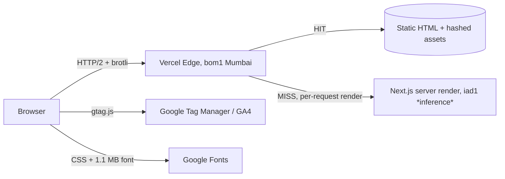

# Cynbit: Backend Technical Audit

**Target:** https://www.cynbit.in/  
**Prepared by:** Sanidhya Bisht, Backend Developer Intern assessment  
**Date of capture:** 1 Nov 2026  
**Method:** passive observation only (see [Scope & Ethics](#1-scope--ethics))

---

## 1. Scope & Ethics

Everything in this report comes from **one normal browser session** (Brave on Android, DevTools → Network → *Export HAR*) plus offline analysis of that file.

- No automated scanners, no fuzzing, no enumeration, no load, no auth bypass attempts.
- No requests were sent to any Cynbit endpoint other than what a regular visitor's browser sends when loading the homepage.
- Offline analysis: [`analysis/har_audit.py`](analysis/har_audit.py), which makes **no network calls**.
- Two captures were taken: a first, partly cached one ([`har-summary-warm.txt`](evidence/har-summary-warm.txt)) and a second with **Disable cache** ticked ([`har-summary-cold.txt`](evidence/har-summary-cold.txt)). **All figures below come from the cold capture** unless stated.

### Limits of this audit (read before the findings)
| Limit | Effect |
|---|---|
| Single device and network (Brave on Android, one run). | Timings are indicative, not benchmarks; a Lighthouse run with throttling would firm them up. |
| The first (warm) capture suggested HSTS was inconsistent; the cold capture showed it is on every response. | The warm result was a `304` artefact. F-02 has been corrected accordingly. |
| Only the homepage load plus the browser's automatic route prefetches were observed. | Other pages (blog, careers, case studies) were seen only through their prefetch responses. |
| The site exposes **no first-party JSON API, no login and no form** that I observed. | Authentication and input-validation findings are *opportunities* rather than defects. I do not claim vulnerabilities that I could not observe. |

Items marked **(inference)** are conclusions drawn from headers or code, not directly confirmed.

---

## 2. Observed Architecture



| Layer | Evidence |
|---|---|
| Hosting / CDN | `server: Vercel`, `x-vercel-id: bom1::...`, `x-vercel-cache: HIT/MISS` |
| Framework | Next.js **App Router** with React Server Components: `/_next/static/...`, `?_rsc=` requests with `text/x-component`, route groups such as `(marketing)` |
| Rendering mix | Prerendered: `/`, `/contact` (`x-nextjs-prerender: 1`, `HIT`). Per-request: `/careers`, `/case-studies`, `/blog/[slug]` (`MISS`, `no-store`) |
| Transport | HTTP/2, brotli on JS/CSS/RSC, immutable 1-year caching on hashed assets |
| API surface | **No first-party REST/GraphQL calls observed.** The only "data" requests are RSC route payloads |
| Contact flow | `mailto:` links only (`opportunities@cynbit.in`, `support@cynbit.in`); no form POST |
| Analytics | GA4 `G-LK6CQWCWX0` via `googletagmanager.com` |
| Cookies | **0** first-party `Set-Cookie` headers |

### Request profile (cold homepage load, cache disabled)
- 40 requests (all `200`), 37 first-party, 3 third-party hosts (`googletagmanager.com`, `fonts.googleapis.com`, `fonts.gstatic.com`)
- `DOMContentLoaded` **281 ms**, `load` **2,681 ms**
- **1.50 MB transferred in total, of which 1.14 MB (76 %) is a single icon font**; all first-party resources together are only 358 KB
- HTML: 100 KB decoded → **15.6 KB** over the wire (brotli), server wait ≈ 60 ms, CDN `HIT`
- First-party JS: 747 KB decoded → **232 KB** brotli (this includes prefetched route chunks); CSS: 208 KB decoded → **28.6 KB** brotli

---

## 3. Findings

Severity reflects a *marketing site with no authentication or stored user data*. They would rise if the site later adds forms or accounts.

| ID | Category | Finding | Severity |
|---|---|---|---|
| F-01 | Security | No CSP, `X-Content-Type-Options`, `X-Frame-Options`/`frame-ancestors`, `Referrer-Policy`, `Permissions-Policy` on any of 37 first-party responses (confirmed on a cold load) | Medium |
| F-02 | Security | HSTS is present on all responses (`max-age=63072000`) but without `includeSubDomains` or `preload` | Low |
| F-03 | Data handling | Contact relies on plaintext `mailto:` links: no server-side validation, rate limiting or spam control, and addresses/phones are scrapeable | Low (opportunity) |
| F-04 | Performance / Architecture | `/careers`, `/case-studies`, `/blog/[slug]` are rendered per request (`no-store`, `MISS`, 270-330 ms) vs 81-148 ms for prerendered/CDN-hit routes | Medium |
| F-05 | Performance | 1.14 MB full Material Symbols icon font = **76 % of all bytes transferred**, loaded for a handful of icons behind a third-party stylesheet | **High** (for a marketing page) |
| F-06 | Performance | Of three large framework/shared JS chunks (127-174 KB decoded, 44-56 KB over the wire), two took 2.0-2.3 s to arrive on this connection while the font download was in flight | Low |
| F-07 | Reliability / Privacy | Runtime dependencies on third-party placeholder hosts: `i.pravatar.cc` (avatar images), `transparenttextures.com` (background), Unsplash fallback image | Low |
| F-08 | SEO / Correctness | `og:image` is an **SVG** (not rendered by most social crawlers); `og:url` and JSON-LD use the apex host while pages serve from `www`; no canonical tag; brand duplicated in `<title>` | Low |
| F-09 | Privacy | GA4 loads unconditionally on first paint; no consent mechanism observed in the capture | Low |
| F-10 | Informational | `access-control-allow-origin: *` on static chunks **and on the HTML document**; Next.js build ID in an HTML comment; CDN edge IDs in headers | Info |

### Details

#### F-01: Missing browser-hardening headers (Medium)
**Evidence** (`evidence/har-summary-cold.txt`, cache disabled):
```
content-security-policy    0/37     x-content-type-options   0/37
x-frame-options            0/37     referrer-policy          0/37
permissions-policy         0/37     cross-origin-opener-policy 0/37
```
**Impact:** the site can be framed by any origin (clickjacking), has no second line of defence against XSS if a vulnerability is ever introduced, and leaks the full URL as referrer to third parties.  
**Confirmed on a cold load**, where all 37 responses were `200` (not `304`), so this is not a caching artefact.  
**Fix:** [`snippets/01-security-headers.next.config.mjs`](snippets/01-security-headers.next.config.mjs). It ships CSP as **Report-Only** first, so nothing breaks, then enforces.

#### F-02: HSTS lacks `includeSubDomains` / `preload` (Low)
*Correction:* my first (warm) capture showed HSTS on only 4 of 37 responses; that was a `304` artefact. The cold capture shows `strict-transport-security: max-age=63072000` on **37/37** responses, a two-year max-age, which is good.  
What is missing is `includeSubDomains; preload`, which protects subdomains and allows HSTS-preload-list submission. Only add `preload` once every subdomain serves HTTPS, because preloading is hard to undo.  
**Fix:** set the full value in the same `headers()` block (snippet 01).

#### F-03: Contact flow has no backend (Low, opportunity)
The `/contact` page is a set of `mailto:` links. That is safe, but it means no spam protection, no delivery tracking and published addresses that bots harvest.  
**Fix:** [`snippets/02-contact-api-route.ts`](snippets/02-contact-api-route.ts), an API route with:
- Zod schema validation and a 10 KB body cap
- Origin check, honeypot field
- Sliding-window rate limit (5 / 10 min / IP) returning `429` + `Retry-After`
- RFC 9457 `application/problem+json` error bodies, and no provider errors leaked to the client

#### F-04: Content routes rendered on every request (Medium)
| Route | `cache-control` | `x-vercel-cache` | Time (cold) |
|---|---|---|---|
| `/contact` | `public, max-age=0, must-revalidate` + `x-nextjs-prerender` | HIT | 81 ms |
| `/products`, `/services` | same | HIT | 95-96 ms |
| `/careers` | `private, no-cache, no-store` | MISS | 328 ms |
| `/blog/[slug]` | `private, no-cache, no-store` | MISS | 288 ms |
| `/case-studies` | `private, no-cache, no-store` | MISS | 270 ms |

The homepage document itself is a clean prerendered CDN hit: ~60 ms wait, 15.6 KB over the wire.  
**(inference)** the three slower routes read data at request time (CMS/DB/uncached `fetch`, or `cookies()`/`headers()` usage), which opts them out of static generation. That adds roughly 200 ms per visit and puts the origin on the critical path under traffic spikes.  
**Fix:** [`snippets/04-isr-for-content-routes.tsx`](snippets/04-isr-for-content-routes.tsx): `generateStaticParams` + `revalidate = 3600` + tag-based on-demand revalidation on publish.

#### F-05: 1.14 MB icon font dominates page weight (High for this page)
On the cold load the Material Symbols variable font (**1,139,055 B over the wire**, uncompressed woff2) was the largest resource by far: 76 % of the 1.50 MB total, 3x the size of *all* first-party JS + CSS + HTML combined (358 KB). It is requested through a third-party stylesheet (`fonts.googleapis.com/css2?family=Material+Symbols+Outlined...`, ~200 ms) and then a second origin (`fonts.gstatic.com`, 280 ms), and costs extra DNS + TLS connections.  
**Fix:** [`snippets/03-subset-icon-font.md`](snippets/03-subset-icon-font.md): request only the used glyphs with `icon_names=`, or replace with tree-shaken inline SVG (also removes two origins from the CSP). Expected effect: removes ~1.1 MB from a 1.5 MB page.

#### F-06: Slow framework chunks on first load (Low)
Brotli keeps the first-party payload small (JS 232 KB, CSS 28.6 KB, so decoded size is *not* a problem). However, on this connection the three largest chunks took **2,349 ms** (`4bd1b696...`, 56 KB), **2,018 ms** (`5563...`, 44 KB) and 266 ms (`1255...`, 46 KB), and `load` fired at 2,681 ms versus `DOMContentLoaded` at 281 ms. **(inference)** this is bandwidth contention with the 1.1 MB font download, which would also explain why the late chunks are so slow for their size; I did not isolate it with a throttled Lighthouse run.  
**Suggested next step:** fix F-05 first, re-measure, then run `@next/bundle-analyzer` if chunks are still slow. I have not identified which libraries are in the ~173 KB chunks, so I make no claim about them.

#### F-07: Third-party placeholder assets in production (Low)
The marketing layout bundle references `https://i.pravatar.cc/150?u=...` (random stock avatars rendered as `alt="user"`), `https://www.transparenttextures.com/patterns/cubes.png` (CSS texture), and an Unsplash URL as a fallback image.  
**Impact:** extra DNS/TLS handshakes, visitors' IPs sent to hosts Cynbit doesn't control, breakage if any host changes, and placeholder avatars that can read as fake social proof.  
**Fix:** self-host (or remove) these assets through `next/image` from `/public`.

#### F-08: Metadata inconsistencies (Low)
- `og:image` / `twitter:image` = `https://cynbit.in/logo.svg`: most social crawlers don't render SVG, so shared links show no preview image.
- `og:url`, JSON-LD `@id`/`url` use `https://cynbit.in`, while the captured pages are served at `https://www.cynbit.in`; there is no `<link rel="canonical">`.
- `<title>` repeats the brand: "Cynbit Technologies | ... | Cynbit Technologies".  
**Fix:** [`snippets/05-seo-metadata.ts`](snippets/05-seo-metadata.ts) (`metadataBase`, title template, canonical, 1200×630 PNG).

#### F-09: Unconditional analytics (Low)
GA4 is preloaded in `<head>` and runs on every visit. India's Digital Personal Data Protection Act, 2023 and the practices of many clients' procurement teams make consent-gated analytics worth reviewing (this is a prompt to check with whoever owns compliance, not a legal conclusion).  
**Fix:** [`snippets/06-consent-gated-analytics.tsx`](snippets/06-consent-gated-analytics.tsx).

---

## 4. What's Already Done Well

Worth stating, because a useful audit is not only a list of faults:

- HTTP/2 with brotli on HTML, JS, CSS and RSC responses (HTML 100 KB → 15.6 KB; CSS 208 KB → 28.6 KB)
- HSTS (`max-age=63072000`) on every first-party response
- Content-hashed static assets with `cache-control: public,max-age=31536000,immutable`
- CDN edge hits served from Mumbai (`bom1`), HTML revalidation via ETag/`304`
- Fast server response: prerendered HTML served from the CDN with ~60 ms wait, and `DOMContentLoaded` at 281 ms on a cold mobile load
- No first-party cookies set, and no first-party API surface to attack
- Pattern scan of captured HTML/JS found **no API keys, tokens or private keys** (`har_audit.py`; this is a pattern scan, not an exhaustive secrets audit)
- Sensible semantic basics: `lang="en"`, `alt` text on all 7 images, `loading="lazy"` on 6 of 7, explicit `width`/`height` to avoid layout shift

---

## 5. Prioritised Roadmap

| Priority | Work | Effort | Why first |
|---|---|---|---|
| 1 | F-05 subset/replace icon font | ~1 h | 76 % of all bytes on the page, trivial change |
| 2 | F-01/F-02 security headers (Report-Only → enforce) | ~2 h | Cheap, broad protection |
| 3 | F-04 static generation + ISR for content routes | ~3 h | Cuts server work and latency |
| 4 | F-08 metadata fixes | ~1 h | Fixes broken link previews |
| 5 | F-03 contact API route | ~4 h | Needed before adding any form |
| 6 | F-06/F-07/F-09 bundle trim, self-host placeholders, consent-gated GA | ~1 day | Hygiene |

---

## 6. Reproducing This Analysis

```bash
# 1. DevTools → Network → tick "Disable cache" → reload → right-click → "Save all as HAR"
# 2. Run the offline analyser (no network access needed)
python3 analysis/har_audit.py capture.har > evidence/har-summary-cold.txt
```

## 7. Repository Layout
```
README.md                 ← this report
analysis/har_audit.py     ← passive HAR analyser
evidence/har-summary-cold.txt  ← cold-load output (source of the numbers above)
evidence/har-summary-warm.txt  ← first, partly cached capture (kept for transparency)
snippets/                 ← recommended improvements (code)
```
